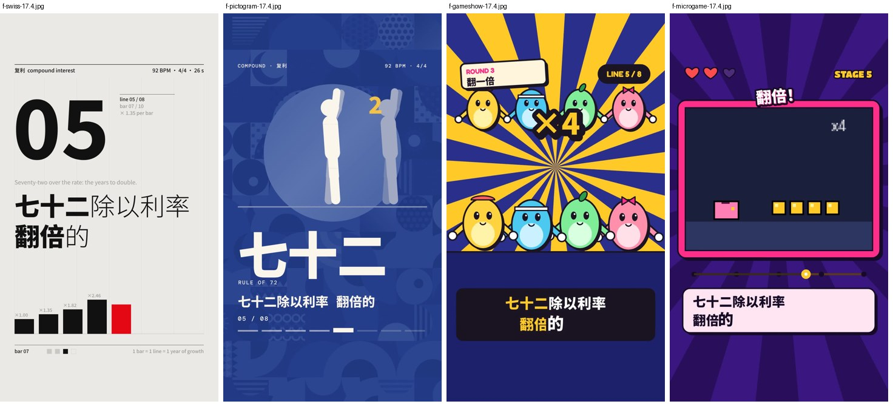

# 说唱样片（测试用）

点视频文件名，再点 **View raw** 或下载按钮观看。这个分支只放测试样片，和 main 没有共同历史，随时可以删。

## 第二轮：说唱对战《复利侠 vs 月光姐》

42 秒，90 BPM boom-bap，ElevenLabs Music v2.5 生成。男声复利侠（存钱派）对女声月光姐（月光族），主持开场，两人轮流各唱两段，最后合唱收尾。歌词带双押（时间/实现、疯狂/风光、武器/复利）。

| 视频 | 做法 |
|---|---|
| [battle-lipsync.mp4](battle-lipsync.mp4) | 角色对口型：嘴型按每个字的拼音和实测人声音量变化，镜头切给拿麦的人，另一位抱臂听；顶部气势条随押韵击中左右摆 |
| [battle-graffiti.mp4](battle-graffiti.mp4) | 涂鸦 / 街头拼贴：每个字在唱到时喷到砖墙上，带流漆；每句贴一张撕边海报；结尾拉远看到整面墙 |
| [battle-rpg.mp4](battle-rpg.mp4) | 像素 RPG 对战：每句是一回合，押韵词是招式名，最后一个字落下时打中扣血；月光姐最后"加入了队伍" |
| [battle-rhyme.mp4](battle-rhyme.mp4) | 押韵可视化：每行一小节 16 格，每个字放在实际唱到的格子里并标拼音；同韵同色，句尾押韵用弧线连起来，双押加括号 |

## 第一轮升级（同一首 26 秒《复利》）

| 视频 | 升级内容 |
|---|---|
| [rap-gameshow-v2.mp4](rap-gameshow-v2.mp4) | 画面缩放冲击、角色压扁跟着伴奏里实测的底鼓和军鼓；唱到的字随人声音量放大；逐字时间改用分轨后的干净人声 |
| [rap-pictogram-v2.mp4](rap-pictogram-v2.mp4) | 背景图案每一下底鼓整行跳格；太阳圆盘随人声起伏；唱到的字放大；逐字时间改用干净人声 |

## 第一轮原版

| 视频 | 风格 |
|---|---|
| [rap-swiss.mp4](rap-swiss.mp4) | 瑞士动态排版 Swiss Motion |
| [rap-pictogram.mp4](rap-pictogram.mp4) | 象形运动图形 Pictogram Motion |
| [rap-gameshow.mp4](rap-gameshow.mp4) | 综艺节奏扁平 Game Show Flat |
| [rap-microgame.mp4](rap-microgame.mp4) | 微游戏快闪 Microgame Frenzy |

