<div align="center">

# Lemo-DeepSeek · riversxiao

**用 DeepSeek Flash + 锁定引擎底座，做纯代码短片（不用视频大模型）**

<a href="DEEPSEEK.md"></a>
<a href="AGENTS.deepseek.md"></a>
<a href="showcase/README.md"></a>
<a href="https://github.com/riversxiao/lemo-opuscar/releases/tag/showcase-v001"></a>
<a href="README.md"></a>

本 fork：[github.com/riversxiao/lemo-opuscar](https://github.com/riversxiao/lemo-opuscar)

ℹ️ **本 fork 默认 DeepSeek Flash；引擎底座仍来自上游 Opus demo。**  
上游是 [lemomo-ai/lemo-opuscar](https://github.com/lemomo-ai/lemo-opuscar)（Opus 风格引擎）；本仓库改成 DeepSeek 工作流 + 自有试片 showcase。

</div>

## 我的试片

下面四支是**样片题材示例**（当前用金融词卡演示多风格）。题材可换成任意故事——产品、宠物、旅行、教程都行。DeepSeek Flash 编排、官方 demo 引擎锁定；成片在 Release，静帧在仓库。

| 主题 | 风格 | 静帧 | 成片 |
|---|---|---|---|
| 复利 | Swiss Motion | [stills](showcase/stills/fuli-01.jpg) | [mp4](https://github.com/riversxiao/lemo-opuscar/releases/download/showcase-v001/fuli-swiss-ds-v001.mp4) |
| 分散投资 | Pictogram Motion | [stills](showcase/stills/fensan-01.jpg) | [mp4](https://github.com/riversxiao/lemo-opuscar/releases/download/showcase-v001/fensan-pictogram-ds-v001.mp4) |
| 流动性 | Caption News | [stills](showcase/stills/liudong-01.jpg) | [mp4](https://github.com/riversxiao/lemo-opuscar/releases/download/showcase-v001/liudong-caption-ds-v001.mp4) |
| 对冲是什么 | Whiteboard | [stills](showcase/stills/duichong-01.jpg) | [mp4](https://github.com/riversxiao/lemo-opuscar/releases/download/showcase-v001/duichong-whiteboard-ds-v001.mp4) |

完整说明与对照 → [`showcase/README.md`](showcase/README.md) · 规程 → [`AGENTS.deepseek.md`](AGENTS.deepseek.md) · 用法 → [`DEEPSEEK.md`](DEEPSEEK.md)

## 怎么用（本 fork · DeepSeek）

日常请走这条路径。不要装上游的 Claude Code 插件。

### 1. Clone 本仓库

```sh
git clone https://github.com/riversxiao/lemo-opuscar.git
cd lemo-opuscar

# 可选：钉死 DeepSeek 控制层提交（完整 40 字符 SHA；勿用裸上游 413a6bd）
export LEMO_OPUSCAR_PIN=f3d2e1c934be18ac4cb816ecaa5e9d27176afaae

sh plugin/skills/lemo-deepseek/scripts/setup.sh
sh plugin/skills/lemo-deepseek/scripts/setup.sh deps
# 需要旁白：
# sh plugin/skills/lemo-deepseek/scripts/setup.sh deps voice
# 需要拨弦：
# sh plugin/skills/lemo-deepseek/scripts/setup.sh deps music
```

### 2. 挂上 DeepSeek 技能

把宿主（OpenCode / Cursor / 自建 Agent）的技能指向：

`plugin/skills/lemo-deepseek/SKILL.md`

并让 agent 先读：`AGENTS.deepseek.md` → `AGENTS.md` → `DIRECTOR.md` → `TECHNIQUE.md` → 所选 `styles/<slug>/STYLE.md`。

### 3. 开工一句话（任意题材）

> 用 Swiss Motion 做一支 30 秒片子，讲「复利」——或换成你的任何主题。

> 用 Caption News 做一支 30 秒片子，讲流动性 / 橘猫 / 产品发布均可。

规程摘要：TREATMENT → `setup.sh demo <slug>` → 只改内容层 → still → TTS → video → mix → mux。详见 [`DEEPSEEK.md`](DEEPSEEK.md)。

> `setup.sh` 现在会拒绝缺少 DeepSeek 覆盖层的库或 PIN；钉版本请用完整 SHA（见 [`DEEPSEEK.md`](DEEPSEEK.md) / [`docs/NEXT-ROUND.md`](docs/NEXT-ROUND.md)）。

### 前提

- Node 20+、ffmpeg、Python 3.11+
- 出网（edge-tts 中文旁白；或改离线 Kokoro）
- DeepSeek Flash 宿主任选其一：
  - **官方 API（推荐，有 Key 时）**：OpenCode 里 `/connect` → 选 `deepseek` → 填 `DEEPSEEK_API_KEY`（[platform.deepseek.com](https://platform.deepseek.com) 申请）→ 模型 `deepseek-flash`（或 `deepseek-v4-pro`）；base URL `https://api.deepseek.com`
  - **OpenRouter 回退**：`openrouter/deepseek/deepseek-v4.1-flash`
  - **OpenCode 免费档**：`opencode/deepseek-v4.1-flash-free`（额度不够就换上面两条）

---

## 🎬 特别放映 · 我的样片

<table><tr>
<td width="50%" valign="top"><a href="https://github.com/riversxiao/lemo-opuscar/releases/tag/showcase-v001">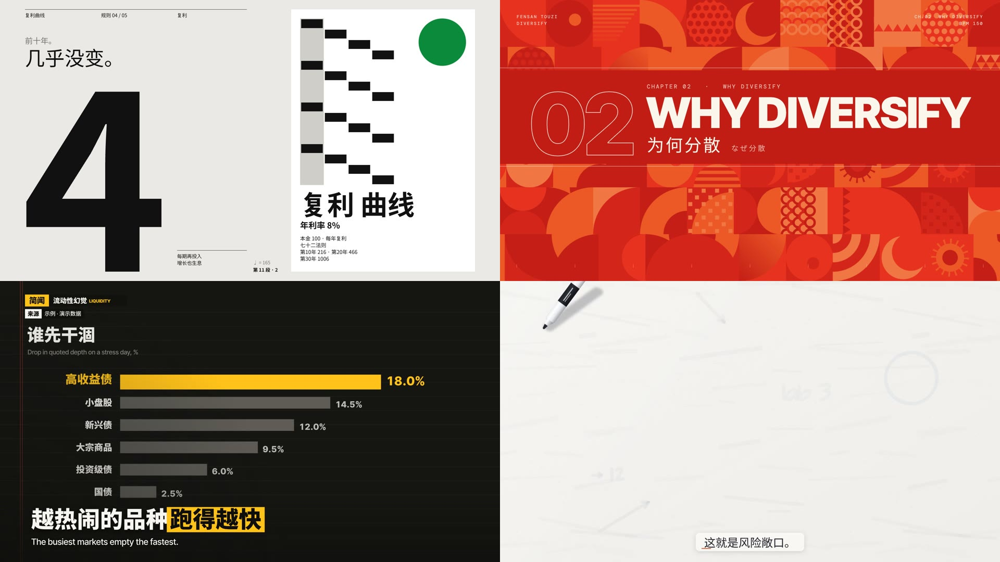</a><br><b>▶ 四支样片</b> · 各约 30 秒<br><sub>复利 · 分散投资 · 流动性 · 对冲——四种风格、同一套 DeepSeek 流程。题材只是样例，换成任意故事都行。</sub></td>
<td width="50%" valign="top"><a href="DEEPSEEK.md">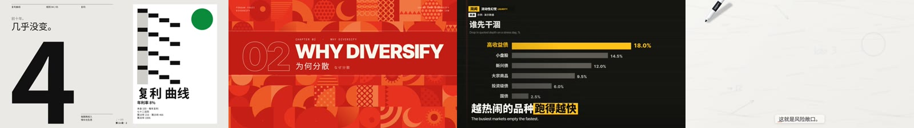</a><br><b>工作流</b> · DeepSeek Flash + 引擎锁定<br><sub>still → TTS / 配乐 → video → mix → mux。只改内容层；锁定的 Opus demo 引擎不动。</sub></td>
</tr></table>

<div align="center">

这些样片的每一帧、每一刀剪辑，都由 **DeepSeek Flash** 在锁定引擎上编排完成。<br>
[**▶ 看 Release**](https://github.com/riversxiao/lemo-opuscar/releases/tag/showcase-v001) · [**Showcase 目录**](showcase/README.md) · [**DEEPSEEK.md**](DEEPSEEK.md)

</div>

## 👋 关于本 fork

由 **[riversxiao](https://github.com/riversxiao)** 维护：DeepSeek 工作流 + 自有试片。  
上游引擎与风格库来自 **Lemomo** / [lemomo-ai/lemo-opuscar](https://github.com/lemomo-ai/lemo-opuscar)。

> **这不是 awesome 合集。** 上方高亮片子都是在这里用 **DeepSeek Flash** + 代码引擎做的。<br>
> 题材是样片（金融词卡是第一批）。产品、宠物、旅行、教程——同一条流水线。下面是完整风格墙，供引擎锁定 demo 使用。

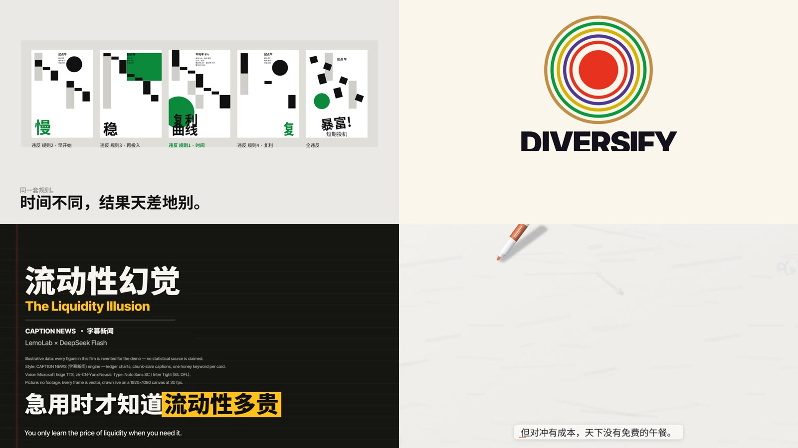

## 怎么做出来的（本 fork）

每一支片子都是 agent 写代码导演、作画、配乐、混音：

- 🎨 **画面**：Canvas / WebGL 页面逐帧渲染
- 🎵 **音乐**：采样 / 拨弦配乐（可选）
- 🎙️ **配音**：edge-tts 或 Kokoro 旁白

不用视频生成大模型，也不用素材库画面。规程 → [`AGENTS.deepseek.md`](AGENTS.deepseek.md)。日常安装 → 上方 **怎么用**（不要走 Claude marketplace 插件）。

## 风格

本 fork 风格墙——缩略图已重新导出到 `docs/frames-ds/`。标了 **riversxiao 样片** 的四格用本仓 stills；其余为库内 demo（引擎锁定）。点图看 `STYLE.md`。

<!-- styles:start -->

### 剪辑与纪实

<table>
<tr>
<td width="33%" valign="top"><a href="styles/caption-news/STYLE.md">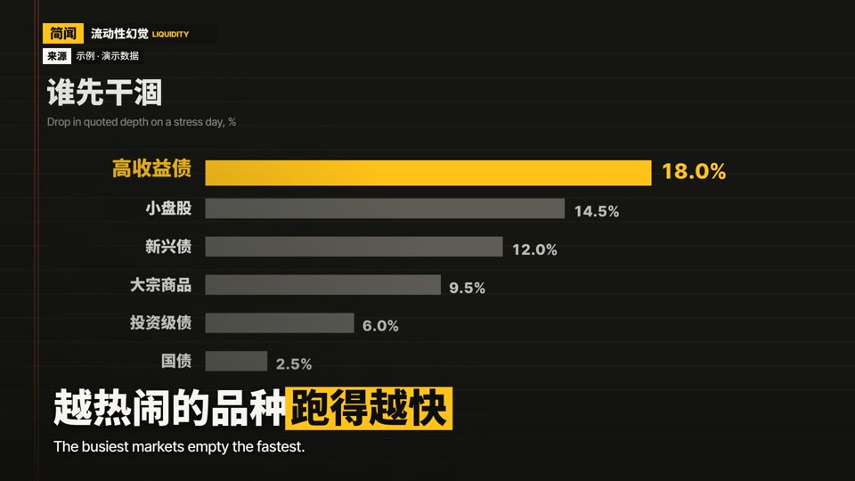</a><br><b>字幕新闻</b><br>Caption News<br><i>流动性 · riversxiao 样片</i><br><sub>DeepSeek Flash 样片；图文优先新闻短片。<a href="https://github.com/riversxiao/lemo-opuscar/releases/download/showcase-v001/liudong-caption-ds-v001.mp4">mp4</a></sub></td>
<td width="33%" valign="top"><a href="styles/newsreel/STYLE.md">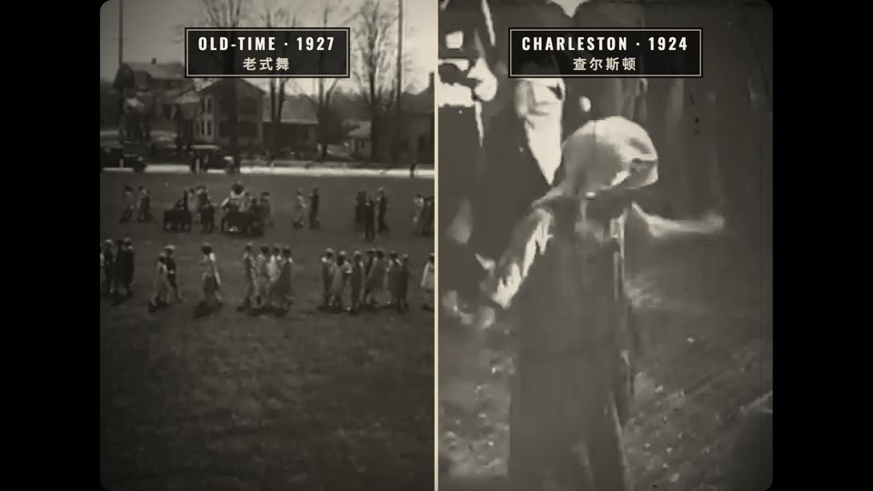</a><br><b>1920s 新闻影片</b><br>1920s Newsreel<br><i>Knock-Knee Alert</i><br><sub>1926 年报纸说查尔斯顿会跳坏膝盖，福特工人野餐会上的孩子照跳不误。</sub></td>
<td width="33%" valign="top"><a href="styles/countdown/STYLE.md">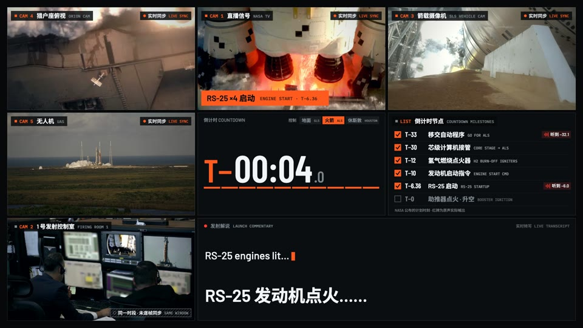</a><br><b>实时倒计时分屏</b><br>Live Countdown Split-screen<br><i>Counting Itself Down</i><br><sub>阿尔忒弥斯二号发射的最后一分钟，一秒不剪：格子从 1 开到 9，点火合成 1。</sub></td>
</tr>
<tr>
<td width="33%" valign="top"><a href="styles/city-symphony/STYLE.md">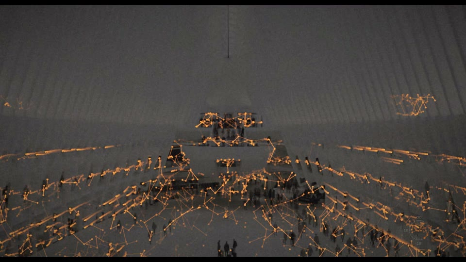</a><br><b>延时交响</b><br>Time-lapse Symphony<br><i>One Day in New York</i><br><sub>纽约的一天：延时光河、踩着十六分音符的网格，1899 年和今天并排。</sub></td>
<td width="33%" valign="top"><a href="styles/visual-investigation/STYLE.md">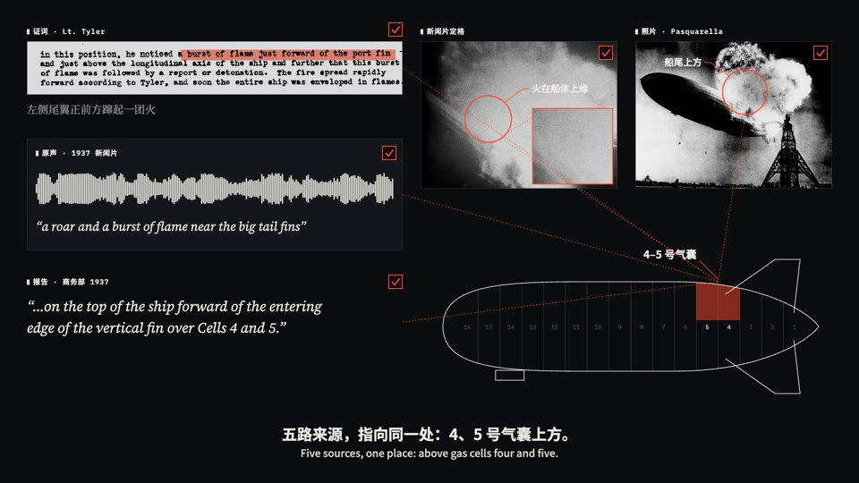</a><br><b>视觉调查</b><br>Visual Investigation<br><i>The Hindenburg: Four Minutes, 32 Seconds</i><br><sub>新闻片、照片、证词和调查报告排上同一条时间轴，五路来源指向一处。</sub></td>
<td width="33%" valign="top"><a href="styles/kino-montage/STYLE.md">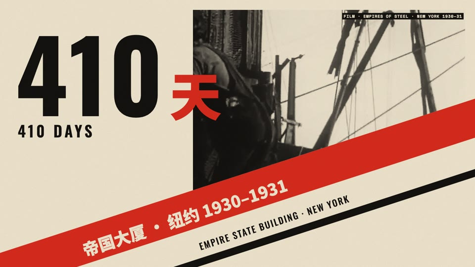</a><br><b>构成主义蒙太奇</b><br>Constructivist Montage<br><i>410 Days</i><br><sub>帝国大厦的小册子写着建造者，工地实拍和老照片给出答案：每天 2,500 人。</sub></td>
</tr>
<tr>
<td width="33%" valign="top"><a href="styles/telestrator/STYLE.md">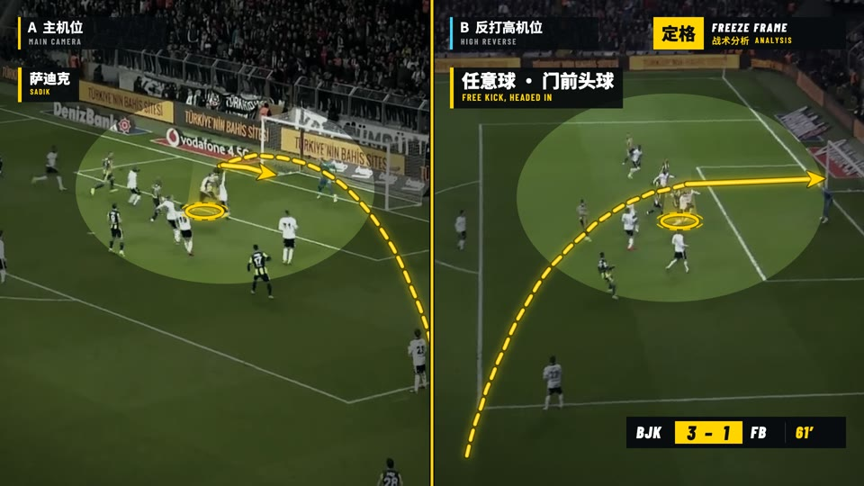</a><br><b>体育战术板</b><br>Sports Telestrator<br><i>Freeze Frame</i><br><sub>半场 0–3，费内巴切 12 分钟连进三球：冻住画面、画线、分屏、射门图。</sub></td>
<td width="33%" valign="top"><a href="styles/news-package/STYLE.md">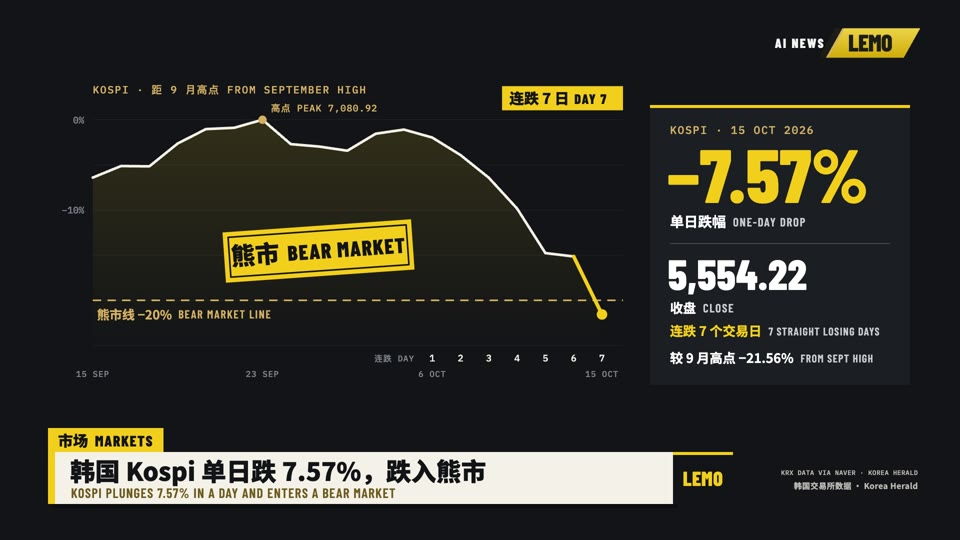</a><br><b>电视新闻包装</b><br>Broadcast News Package<br><i>The Week in AI</i><br><sub>一周四条 AI 新闻，一整套电视台包装：串联单、标题条、翻牌价格表、规格卡。</sub></td>
</tr>
</table>

### 实证影像

<table>
<tr>
<td width="33%" valign="top"><a href="styles/satellite-briefing/STYLE.md">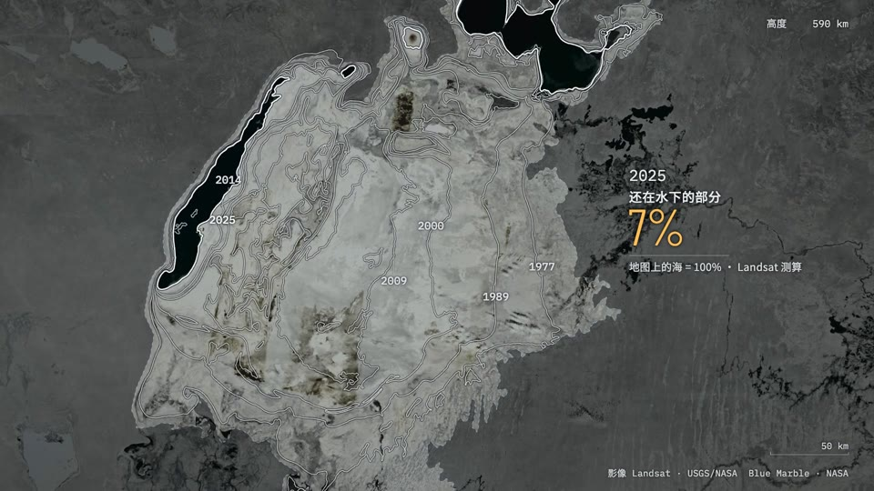</a><br><b>卫星简报</b><br>Satellite Briefing<br><i>The Map Still Says Sea</i><br><sub>卫星照着地图去找咸海，找到的是沙漠；只有筑了坝的那一块回来了。</sub></td>
<td width="33%" valign="top"><a href="styles/briefing-board/STYLE.md">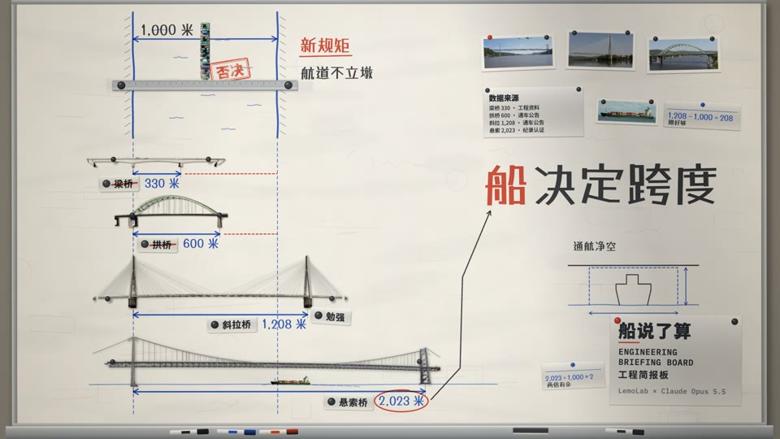</a><br><b>工程简报板</b><br>Engineering Briefing Board<br><i>The Ship Decides</i><br><sub>一条河要架桥，四种桥型在一面简报墙上逐个受检，拍板的是桥下要过的船。</sub></td>
<td width="33%" valign="top"><a href="styles/lidar-survey/STYLE.md">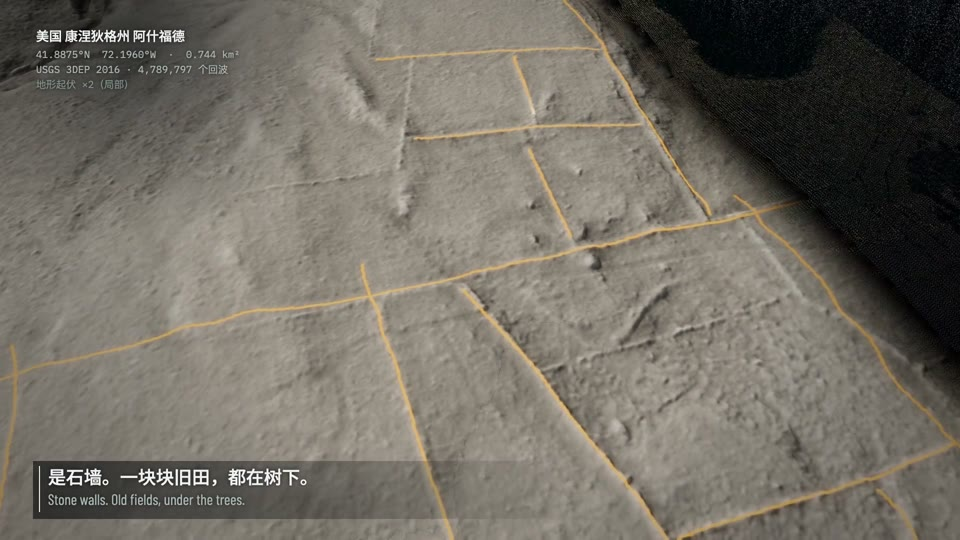</a><br><b>点云测绘</b><br>LiDAR Survey<br><i>The Fields Under the Forest</i><br><sub>激光点云剥掉一片森林的树冠，露出当年农田的石墙：3.4 公里。</sub></td>
</tr>
<tr>
<td width="33%" valign="top"><a href="styles/white-model/STYLE.md">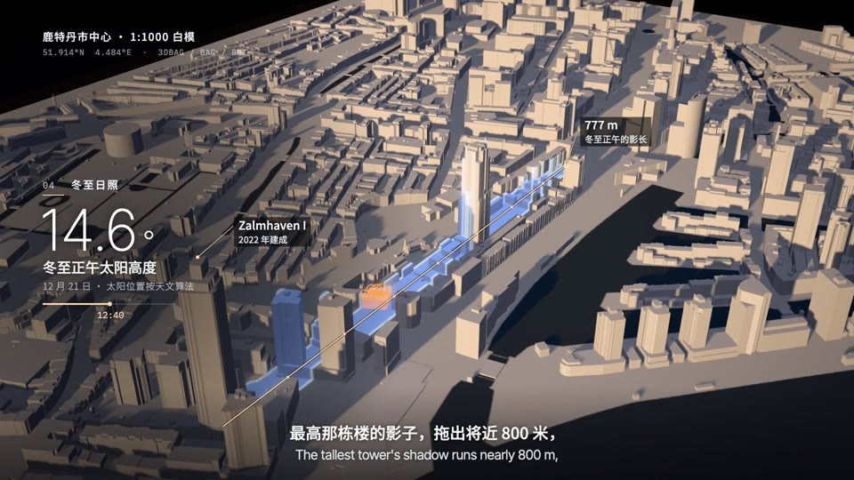</a><br><b>白模投影</b><br>Projection on White Model<br><i>How a Flattened City Grew Back</i><br><sub>投影机把数据一层层刷上鹿特丹白模：从 1940 年的空洞到今天的塔楼。</sub></td>
<td width="33%" valign="top"><a href="styles/data-physical/STYLE.md">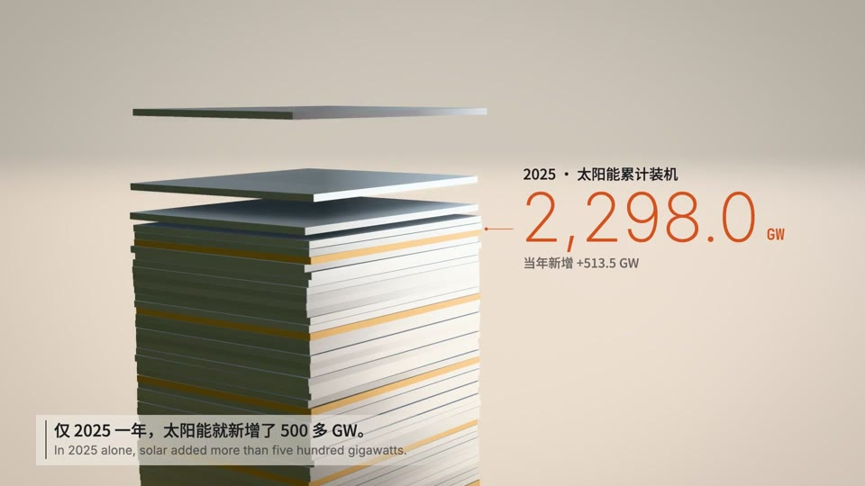</a><br><b>数据实物化</b><br>Data Physicalization<br><i>Two Spirals</i><br><sub>十二年风电和太阳能装机叠成实物，绕表盘升成两条螺旋，2021 年太阳能反超。</sub></td>
<td width="33%" valign="top"><a href="styles/teardown/STYLE.md">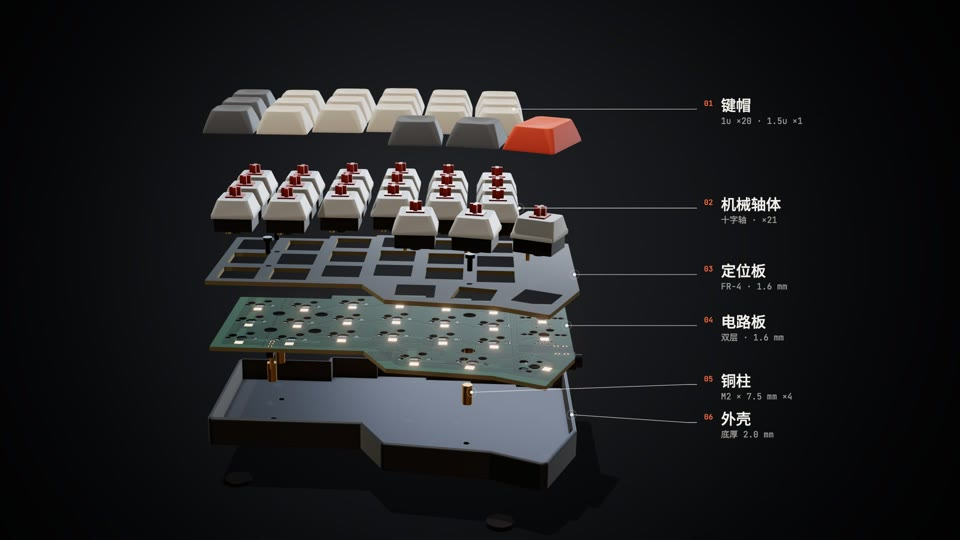</a><br><b>产品拆解</b><br>Exploded Teardown<br><i>21 Keys, Opened</i><br><sub>开源键盘的一半在一次环绕中逐层拆开，看到主控再合拢，标上真实尺寸。</sub></td>
</tr>
<tr>
<td width="33%" valign="top"><a href="styles/microscope/STYLE.md">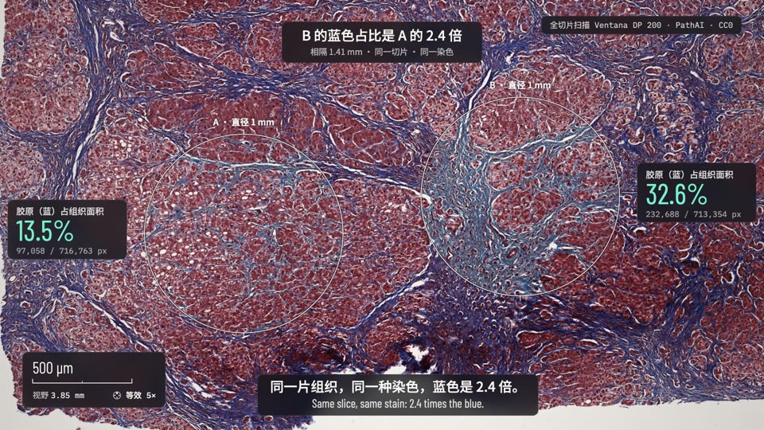</a><br><b>显微叙事</b><br>Microscope Story<br><i>Measured Blue</i><br><sub>一镜从肝组织玻片推到单个细胞核，两个圆逐像素数出 2.4 倍的蓝。</sub></td>
<td width="33%" valign="top"><a href="styles/archive-lighttable/STYLE.md">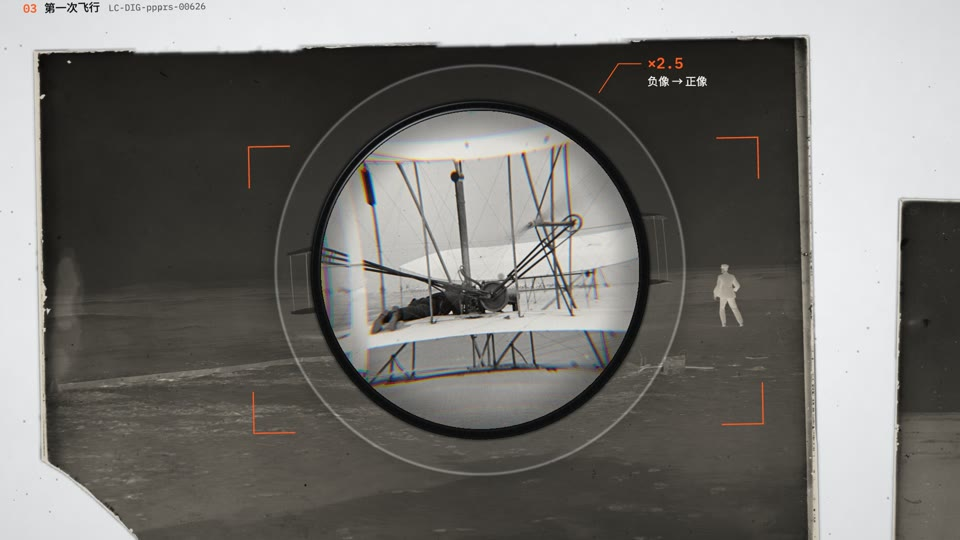</a><br><b>档案灯台</b><br>Archive Light Table<br><i>Two Seconds Short</i><br><sub>电报说最长飞了 57 秒；放大镜下，莱特兄弟的底片和档案说是 59 秒。</sub></td>
</tr>
</table>

### 手绘与绘画

<table>
<tr>
<td width="33%" valign="top"><a href="styles/crayon-book/STYLE.md"></a><br><b>蜡笔儿童绘本</b><br>Crayon Picture Book<br><i>The Moon Can&#x27;t Sleep</i><br><sub>月亮失眠了，小女孩爬上屋顶给它唱摇篮曲。</sub></td>
<td width="33%" valign="top"><a href="styles/watercolor/STYLE.md">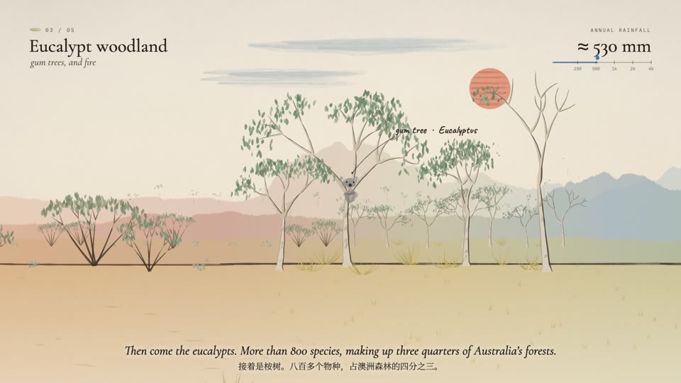</a><br><b>水彩笔刷</b><br>Watercolor Brush<br><i>Follow the Rain</i><br><sub>跟着降雨从澳洲红色腹地一路画到绿色海岸，一镜到底。</sub></td>
<td width="33%" valign="top"><a href="styles/ink-wash/STYLE.md">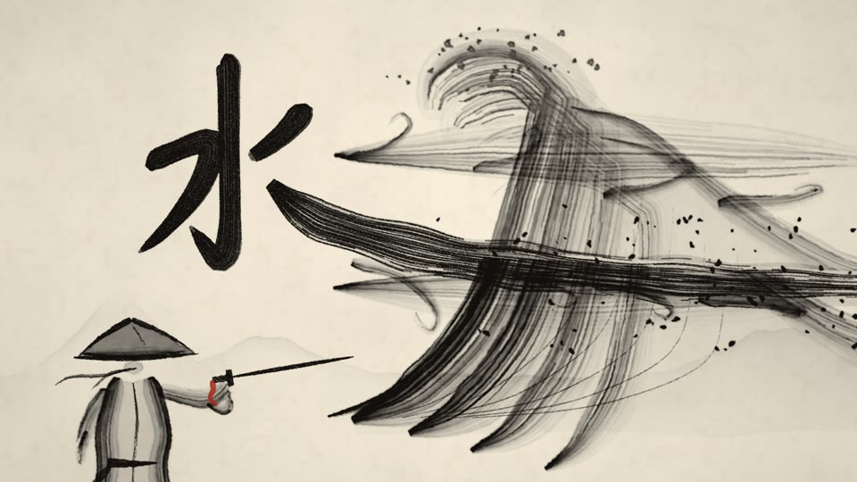</a><br><b>中国水墨</b><br>Chinese Ink Wash<br><i>The Swordsman and the River</i><br><sub>侠客踏水过江，一剑断流。</sub></td>
</tr>
<tr>
<td width="33%" valign="top"><a href="styles/impasto/STYLE.md">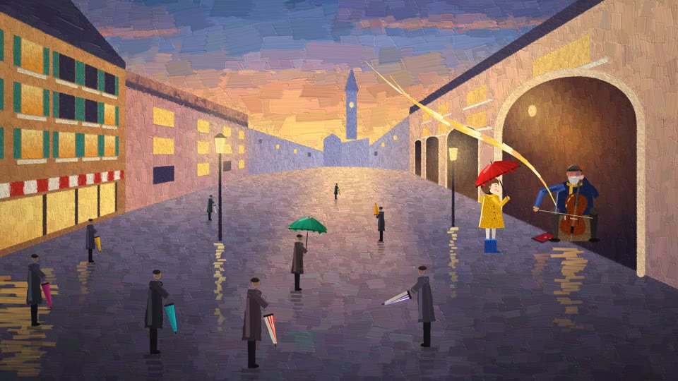</a><br><b>油画厚涂</b><br>Impasto Oil Painting<br><i>The Colour of Rain</i><br><sub>灰色雨中广场，第一把红伞撑开，圆舞曲把整个广场刷上颜色。</sub></td>
<td width="33%" valign="top"><a href="styles/one-line/STYLE.md">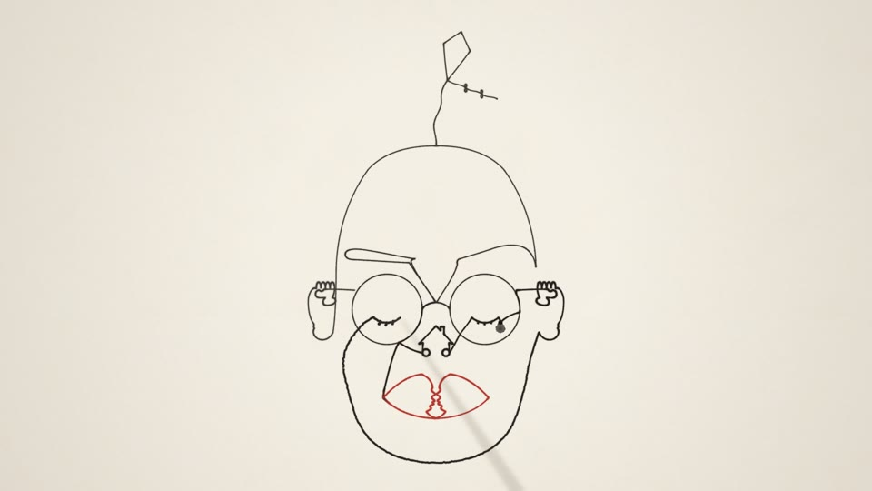</a><br><b>一笔画</b><br>One-line Drawing<br><i>The Line That Never Lifted</i><br><sub>一根不离纸的线画完一个人的一生，再把笔交给孩子。</sub></td>
<td width="33%" valign="top"><a href="styles/whiteboard/STYLE.md">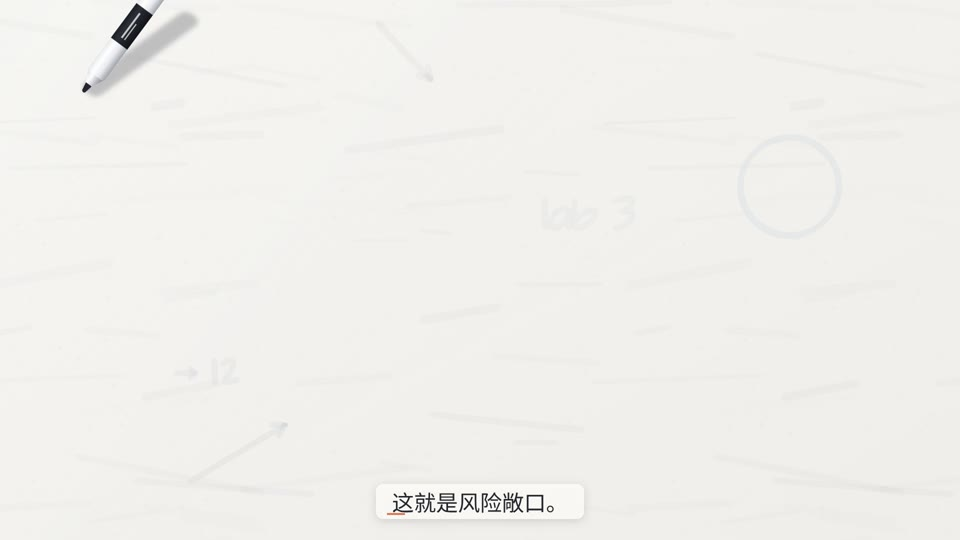</a><br><b>白板讲解</b><br>Whiteboard Explainer<br><i>对冲是什么 · riversxiao 样片</i><br><sub>DeepSeek Flash 样片；白板 + 云希旁白。<a href="https://github.com/riversxiao/lemo-opuscar/releases/download/showcase-v001/duichong-whiteboard-ds-v001.mp4">mp4</a></sub></td>
</tr>
<tr>
<td width="33%" valign="top"><a href="styles/urban-sketch/STYLE.md">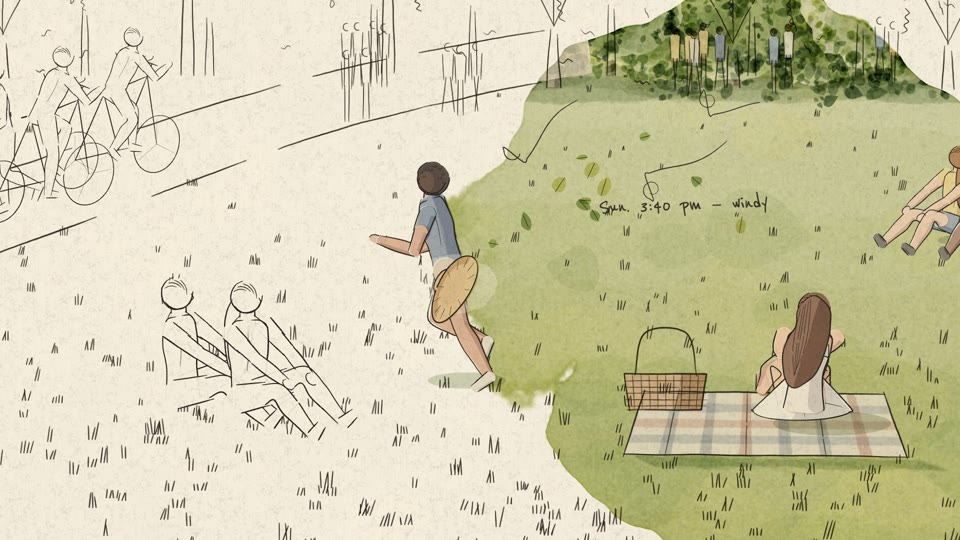</a><br><b>钢笔淡彩</b><br>Urban Sketch · Pen &amp; Wash<br><i>Where the Wind Went</i><br><sub>公园只是一张钢笔速写，风把草帽吹到哪里，哪里才有颜色。</sub></td>
</tr>
</table>

### 东方传统

<table>
<tr>
<td width="33%" valign="top"><a href="styles/shadow-puppet/STYLE.md">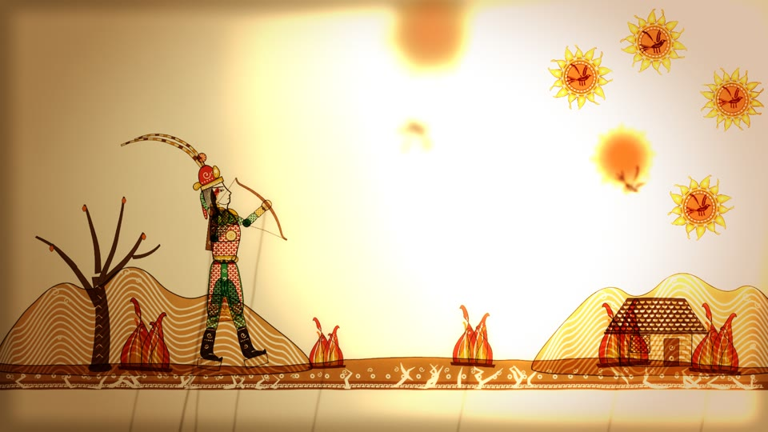</a><br><b>皮影戏</b><br>Shadow Puppetry<br><i>Hou Yi Shoots the Suns</i><br><sub>十日炙烤大地，后羿张弓射日。</sub></td>
<td width="33%" valign="top"><a href="styles/ukiyoe/STYLE.md">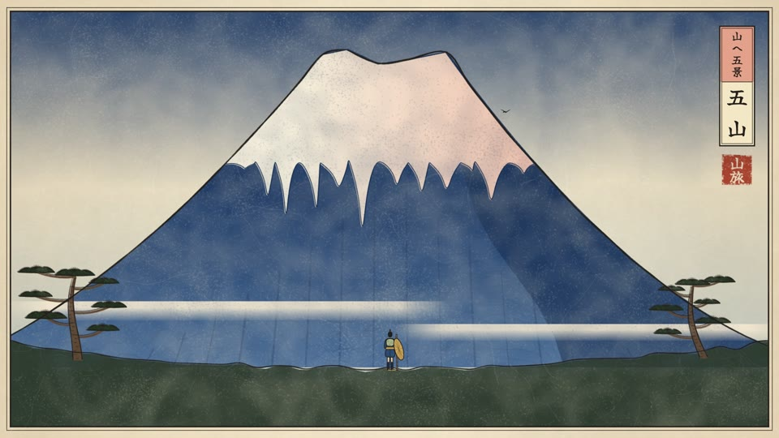</a><br><b>浮世绘</b><br>Ukiyo-e<br><i>Toward the Mountain</i><br><sub>旅人走向远山，每个镜头都是一幅版画；巨浪是高潮，结尾是远山与整幅画轴拉远。</sub></td>
<td width="33%" valign="top"><a href="styles/papercut-red/STYLE.md">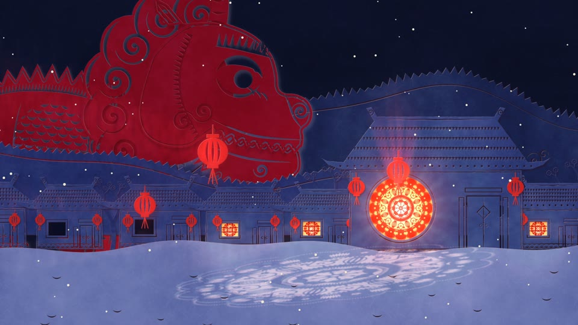</a><br><b>红色窗花剪纸</b><br>Red Paper-cut<br><i>Nian Comes to Town</i><br><sub>除夕年兽进村，小女孩剪出的大窗花照亮全村，把它吓跑。</sub></td>
</tr>
<tr>
<td width="33%" valign="top"><a href="styles/paper-lantern/STYLE.md">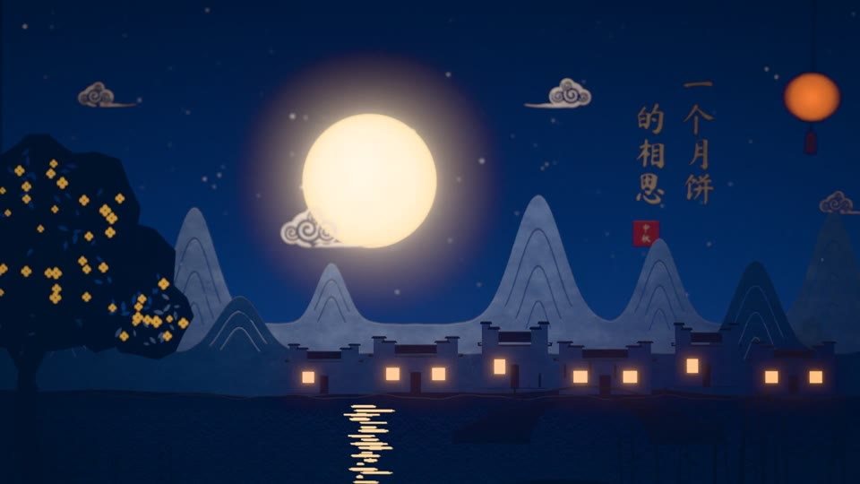</a><br><b>纸雕灯影</b><br>Paper-cut Lightbox<br><i>A Mooncake&#x27;s Longing</i><br><sub>一枚月饼讲中秋的团圆与思念，纸雕灯箱层层透光。</sub></td>
</tr>
</table>

### 印刷与版画

<table>
<tr>
<td width="33%" valign="top"><a href="styles/risograph/STYLE.md"></a><br><b>Risograph 孔版印刷</b><br>Risograph Print<br><i>Sunday Ride</i><br><sub>周日早晨骑车穿过城市：面包店、公园、河边，每到一处加一版油墨，最后三版套印。</sub></td>
<td width="33%" valign="top"><a href="styles/halftone-dossier/STYLE.md">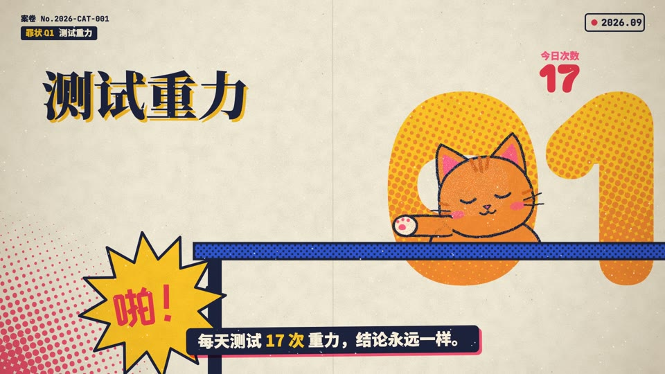</a><br><b>复古半调案卷</b><br>Halftone Dossier<br><i>Case File: Chubby</i><br><sub>橘猫胖橘被立案审查：测试重力、凌晨跑酷，最后无罪释放。</sub></td>
<td width="33%" valign="top"><a href="styles/woodcut/STYLE.md">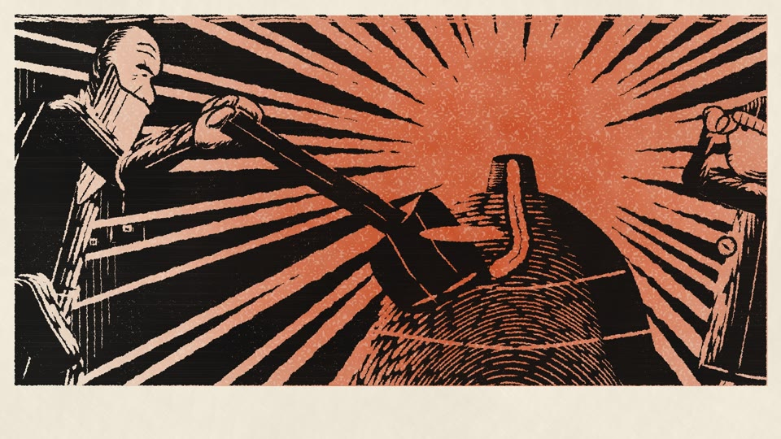</a><br><b>木刻版画</b><br>Woodcut Print<br><i>The Bell Founder</i><br><sub>村子用一整个冬天铸一口钟，钟声第一次响起，雪停了。</sub></td>
</tr>
<tr>
<td width="33%" valign="top"><a href="styles/engraving/STYLE.md">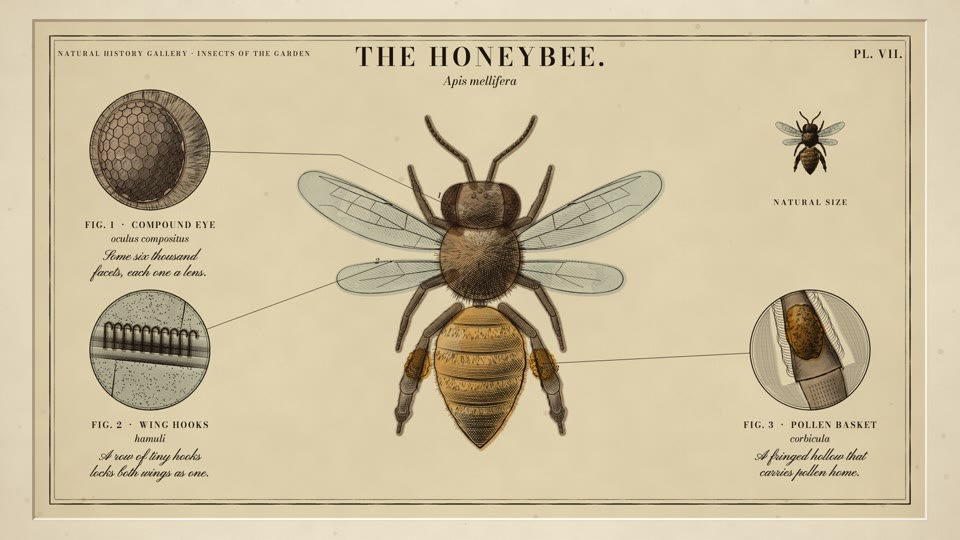</a><br><b>铜版画</b><br>Copperplate Engraving<br><i>The Honeybee, Plate VII</i><br><sub>一张博物志图版自己刻出来：雕刀推开铜版，蜜蜂一线线成形，最后手工水彩上色。</sub></td>
<td width="33%" valign="top"><a href="styles/silkscreen-poster/STYLE.md">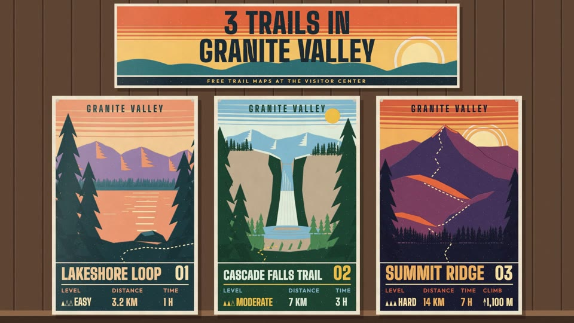</a><br><b>丝印旅行海报</b><br>Silkscreen Travel Poster<br><i>Three Trails</i><br><sub>三条步道各一张丝印海报，一色一刮印出来，再沿山脊一镜到底从正午爬到黄昏。</sub></td>
</tr>
</table>

### 图形与排版

<table>
<tr>
<td width="33%" valign="top"><a href="styles/swiss-motion/STYLE.md">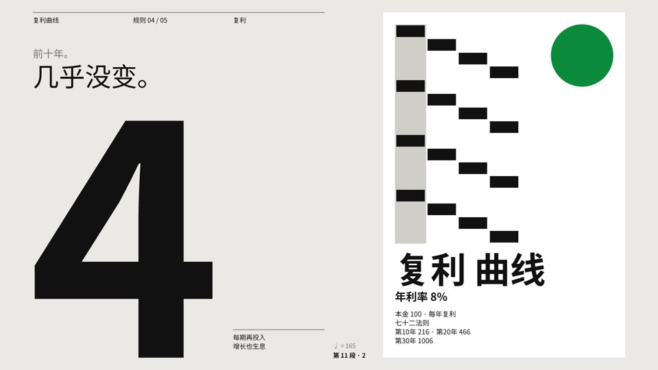</a><br><b>瑞士动态排版</b><br>Swiss Motion Graphics<br><i>复利 · riversxiao 样片</i><br><sub>DeepSeek Flash 样片，锁定 Swiss 引擎；题材可换。<a href="https://github.com/riversxiao/lemo-opuscar/releases/download/showcase-v001/fuli-swiss-ds-v001.mp4">mp4</a></sub></td>
<td width="33%" valign="top"><a href="styles/spy-titles/STYLE.md">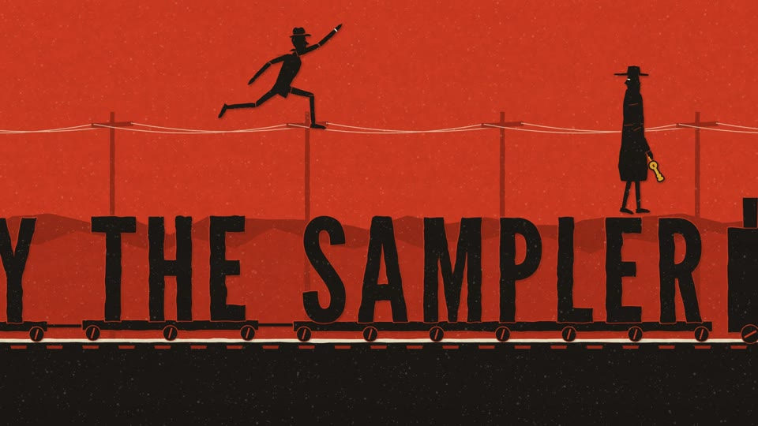</a><br><b>60s 间谍片头</b><br>60s Spy Title Sequence<br><i>The Velvet Cipher</i><br><sub>虚构 1964 年间谍片的片头：追一把被偷的钥匙，几何碎片最后拼成片名。</sub></td>
<td width="33%" valign="top"><a href="styles/art-deco/STYLE.md"></a><br><b>装饰艺术</b><br>Art Deco<br><i>Midnight at the Starlight Hotel</i><br><sub>1930 年的大饭店，门童赶在午夜前把一封信送上顶楼。</sub></td>
</tr>
<tr>
<td width="33%" valign="top"><a href="styles/blueprint/STYLE.md">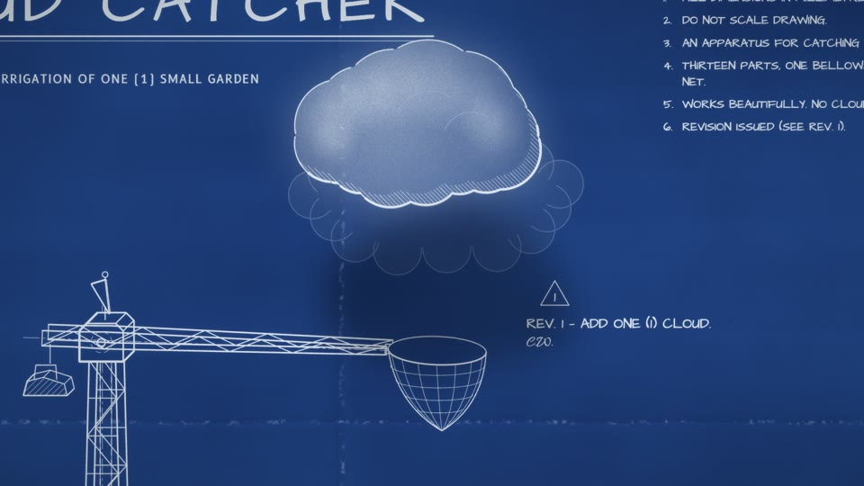</a><br><b>蓝图 / 工程制图</b><br>Blueprint<br><i>Patent Pending: The Cloud Catcher</i><br><sub>发明家的蓝图自己画出一台接云机器，修订云线变成了真的雨云。</sub></td>
<td width="33%" valign="top"><a href="styles/stained-glass/STYLE.md">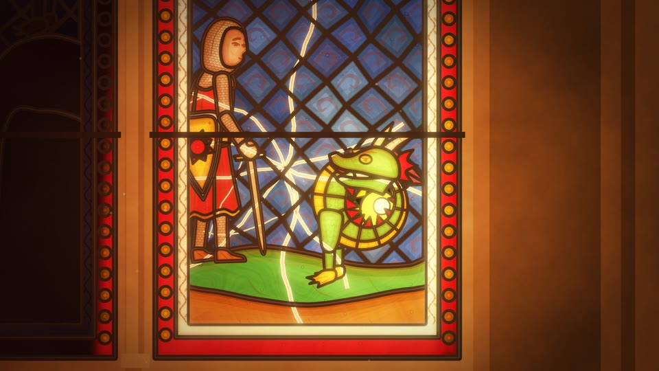</a><br><b>彩色玻璃窗</b><br>Stained Glass<br><i>The Dragon of the East Window</i><br><sub>阳光从清晨移到黄昏，照到哪一格花窗，哪一格的故事就动起来。</sub></td>
<td width="33%" valign="top"><a href="styles/pictogram-motion/STYLE.md">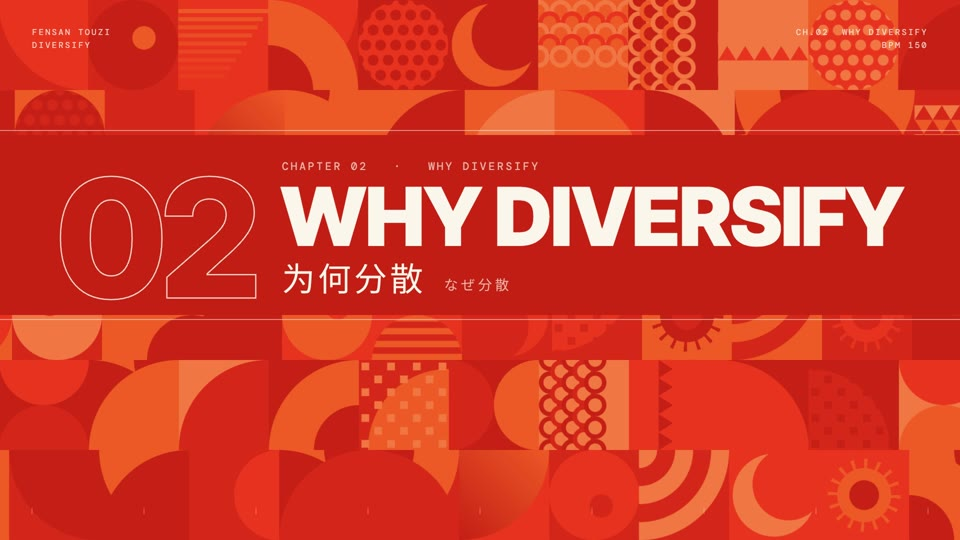</a><br><b>象形运动图形</b><br>Pictogram Motion<br><i>分散投资 · riversxiao 样片</i><br><sub>DeepSeek Flash 样片；鼓点、无旁白。<a href="https://github.com/riversxiao/lemo-opuscar/releases/download/showcase-v001/fensan-pictogram-ds-v001.mp4">mp4</a></sub></td>
</tr>
<tr>
<td width="33%" valign="top"><a href="styles/ascii-crt/STYLE.md">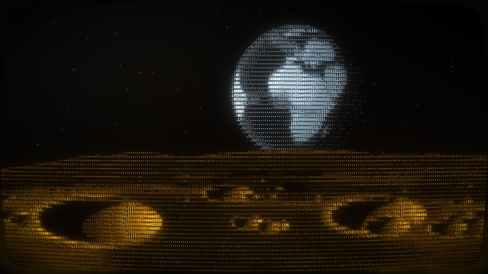</a><br><b>ASCII / CRT 终端</b><br>ASCII / CRT Terminal<br><i>Tranquility.log</i><br><sub>月球基地的 AI 沉睡 40 年后被唤醒，用字符画出“家”来回复。</sub></td>
</tr>
</table>

### 信息与发布

<table>
<tr>
<td width="33%" valign="top"><a href="styles/dataviz/STYLE.md">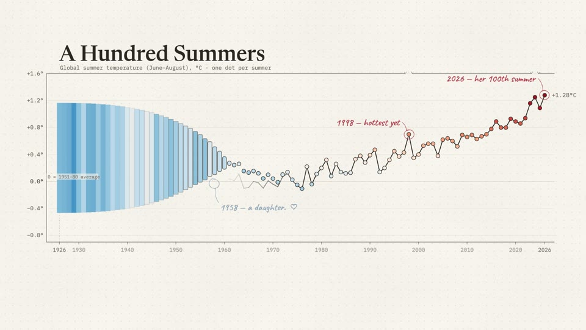</a><br><b>数据叙事</b><br>Data Storytelling<br><i>A Hundred Summers</i><br><sub>一百年的夏季气温，图表本身就是故事。</sub></td>
<td width="33%" valign="top"><a href="styles/iso-infographic/STYLE.md">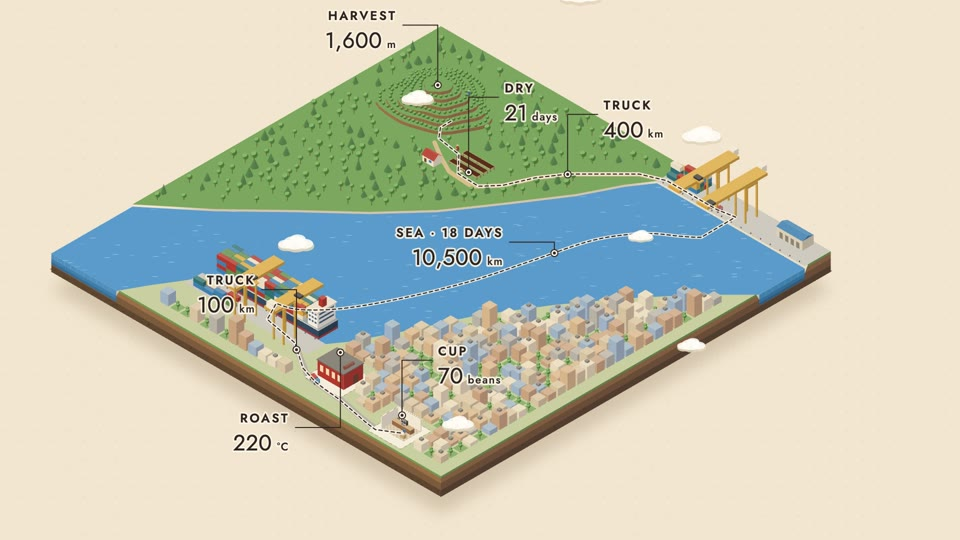</a><br><b>等距信息图</b><br>Isometric Infographic<br><i>From Bean to Cup</i><br><sub>一杯咖啡从种植园到你手里的旅程。</sub></td>
<td width="33%" valign="top"><a href="styles/dark-keynote/STYLE.md">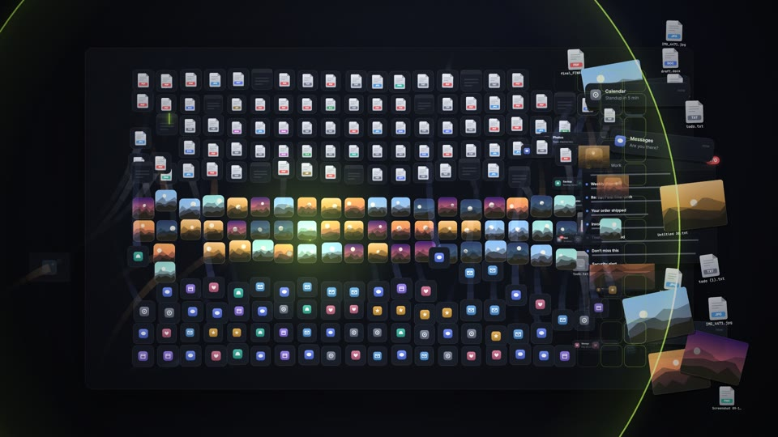</a><br><b>暗色科技发布</b><br>Dark Tech Keynote<br><i>Room to Think</i><br><sub>虚构 app Tidy 的发布片：被埋掉的光标一键把几百个窗口归位。</sub></td>
</tr>
<tr>
<td width="33%" valign="top"><a href="styles/living-screencast/STYLE.md">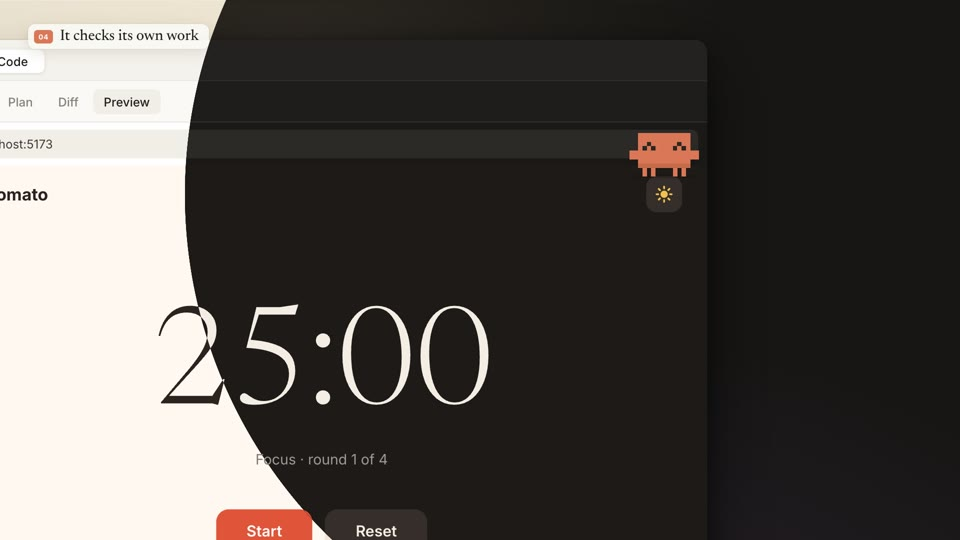</a><br><b>活体实机录屏</b><br>Living Screencast<br><i>Clawd Moves In</i><br><sub>像素小人 Clawd 搬进 Claude 应用，一镜到底演示 Plan 模式和自检。</sub></td>
<td width="33%" valign="top"><a href="styles/hologram-hud/STYLE.md">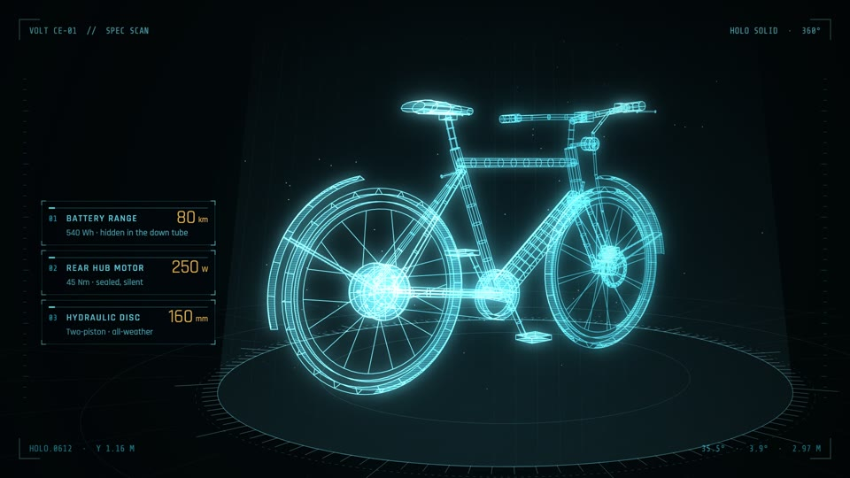</a><br><b>科幻全息界面</b><br>Sci-fi Hologram HUD<br><i>Volt · Spec Scan</i><br><sub>电助力车被扫描成全息线框，目标框依次锁定电池、电机、刹车。</sub></td>
</tr>
</table>

### 卡通与动画

<table>
<tr>
<td width="33%" valign="top"><a href="styles/rubber-hose/STYLE.md"></a><br><b>1930s 橡皮管卡通</b><br>1930s Rubber Hose Cartoon<br><i>Coffee Cup Chase</i><br><sub>一只咖啡杯满厨房追一块逃跑的方糖。</sub></td>
<td width="33%" valign="top"><a href="styles/cel-anime-80s/STYLE.md"></a><br><b>80 年代赛璐璐动画</b><br>80s Cel Anime<br><i>City Lights, 1987</i><br><sub>快递少女骑车穿过雨后霓虹都市，赶在黎明发射前送到一盘磁带。</sub></td>
<td width="33%" valign="top"><a href="styles/scifi-toon/STYLE.md">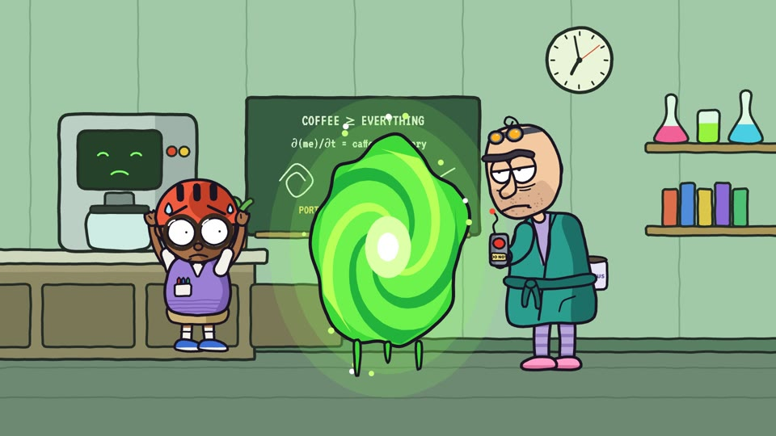</a><br><b>科幻情景喜剧卡通</b><br>Sci-Fi Sitcom Toon<br><i>Coffee Run</i><br><sub>厌世天才开传送门只想买杯咖啡，却穿过越来越离谱的平行宇宙。</sub></td>
</tr>
<tr>
<td width="33%" valign="top"><a href="styles/midcentury-toon/STYLE.md">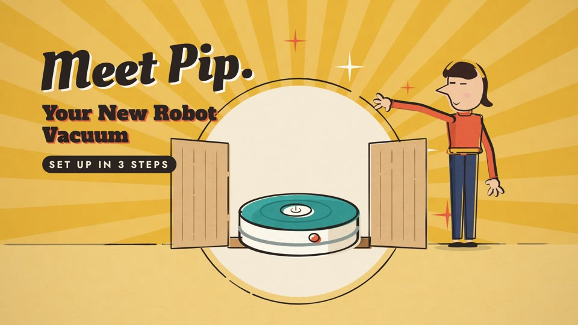</a><br><b>50s 扁平卡通</b><br>Mid-century Cartoon<br><i>Meet Pip</i><br><sub>用 50 年代教育片的口吻，三步教你装好一台扫地机。</sub></td>
</tr>
</table>

### 游戏

<table>
<tr>
<td width="33%" valign="top"><a href="styles/pixel-rpg/STYLE.md">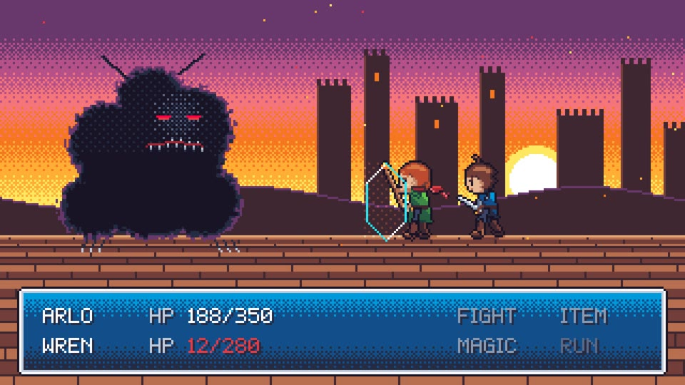</a><br><b>16-bit 像素 RPG</b><br>16-bit Pixel RPG<br><i>The Last Save Point</i><br><sub>勇士在最终 Boss 门前存档，存档画面闪回一路冒险。</sub></td>
<td width="33%" valign="top"><a href="styles/hd-2d/STYLE.md">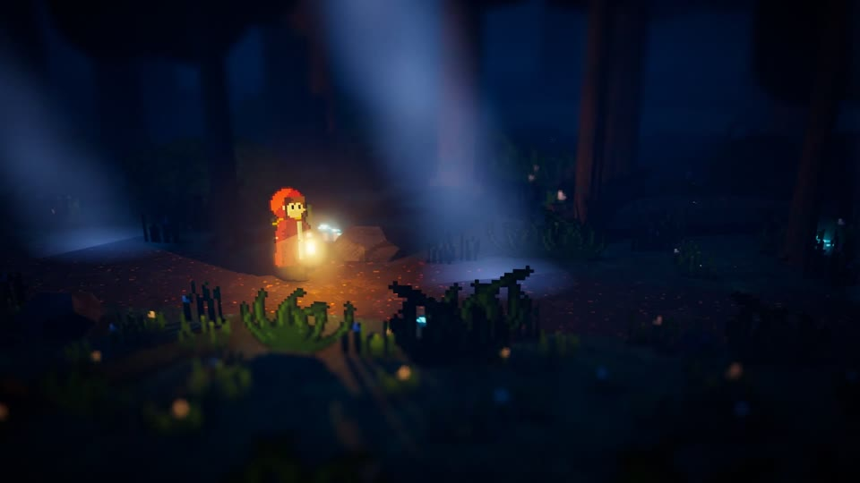</a><br><b>HD-2D</b><br><i>The Lampbearer</i><br><sub>灯塔熄灭，孙女提着最后一簇火穿过夜林、爬上风暴悬崖。</sub></td>
<td width="33%" valign="top"><a href="styles/microgame/STYLE.md">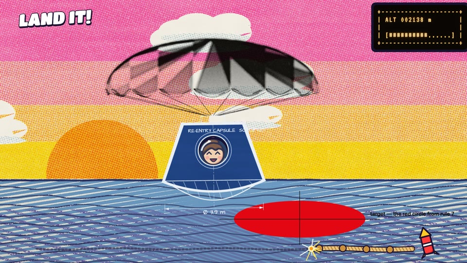</a><br><b>微游戏快闪</b><br>Microgame Frenzy<br><i>Five-Second Astronaut</i><br><sub>见习宇航员闯五秒训练营，越来越快，Boss 关亲手降落回地球。</sub></td>
</tr>
<tr>
<td width="33%" valign="top"><a href="styles/game-show/STYLE.md">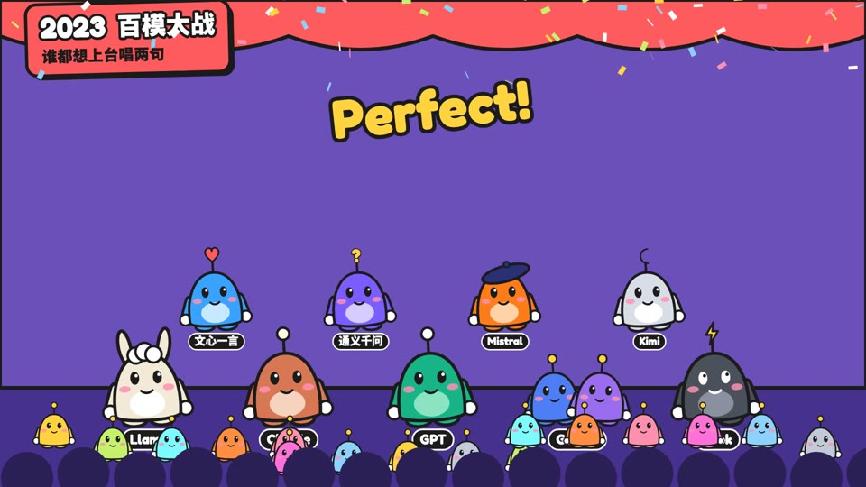</a><br><b>综艺节奏扁平</b><br>Game Show Flat<br><i>Rhythm of AI, 1997 → 2026</i><br><sub>把 AI 发展史做成一局节奏游戏，模型踩着拍登场，最后发成绩单。</sub></td>
</tr>
</table>

### 电影与时代

<table>
<tr>
<td width="33%" valign="top"><a href="styles/silent-film/STYLE.md"></a><br><b>1920s 默片</b><br>1920s Silent Film<br><i>The Runaway Loaf</i><br><sub>面包店学徒追一个滚走的面包，最后掰成两半分给饿肚子的小女孩。</sub></td>
<td width="33%" valign="top"><a href="styles/backrooms/STYLE.md"></a><br><b>后室 / 新怪谈</b><br>Liminal Found Footage<br><i>Night Shift Orientation</i><br><sub>新夜班员工拍下入职第一晚：无尽的黄色办公空间，和墙上的员工守则。</sub></td>
</tr>
</table>

### 材质与 3D

<table>
<tr>
<td width="33%" valign="top"><a href="styles/brick-toy/STYLE.md"></a><br><b>积木玩具</b><br>Brick Toy<br><i>Rocket from Spare Parts</i><br><sub>积木宇航员用零件拼出火箭，飞向积木月亮。</sub></td>
<td width="33%" valign="top"><a href="styles/paper-popup/STYLE.md"></a><br><b>纸片立体书</b><br>Paper Pop-up Book<br><i>Pip&#x27;s Paper Adventure</i><br><sub>立体书在书桌上打开，小精灵 Pip 在纸片世界冒险，最后跳出书外。</sub></td>
<td width="33%" valign="top"><a href="styles/tilt-shift/STYLE.md"></a><br><b>移轴微缩</b><br>Tilt-Shift Miniature<br><i>Toy Town Rush Hour</i><br><sub>玩具城的早高峰，一切都像模型。</sub></td>
</tr>
<tr>
<td width="33%" valign="top"><a href="styles/lowpoly-island/STYLE.md"></a><br><b>低多边形等距</b><br>Low-poly Isometric Island<br><i>The Island That Grew</i><br><sub>空海里一格格长出小岛和村庄，每放一块响一个音符，直到星空。</sub></td>
<td width="33%" valign="top"><a href="styles/glass-product/STYLE.md"></a><br><b>玻璃质感产品</b><br>Glass Product Render<br><i>Aura — Hear the Light</i><br><sub>虚构玻璃耳机 Aura 的开箱与特写。</sub></td>
</tr>
</table>
<!-- styles:end -->

## 授权

本 fork：**riversxiao / Lemo-DeepSeek** · 引擎底座来自 **LemoLab × Claude Opus** demo。

- **代码与文档**（含 `DEEPSEEK.md`、`AGENTS.deepseek.md`、`plugin/skills/lemo-deepseek`）：**MIT**。
- **上游 demo 引擎及其静帧**（`styles/` 中复用时）：[CC BY 4.0](https://creativecommons.org/licenses/by/4.0/deed.zh-hans)——署名 **LemoLab** 并附 [lemomo-ai/lemo-opuscar](https://github.com/lemomo-ai/lemo-opuscar) 链接，改动须注明。
- **riversxiao 样片与静帧**（`showcase/`、Release `showcase-v001`，以及 `docs/frames-ds/` 中四格样片缩略图）：[CC BY 4.0](https://creativecommons.org/licenses/by/4.0/deed.zh-hans)——署名 **riversxiao/lemo-opuscar** 并附本仓库链接。
- **你用本库做出的片子**：归你自己，无须署名。
- **样片中的第三方素材**：沿用各自授权（见各 demo 的 `CREDITS`）。

你在自己片子里使用的素材由你负责。

---

<div align="center">

⭐ **给本 fork 点个星** · [riversxiao/lemo-opuscar](https://github.com/riversxiao/lemo-opuscar)<br>
👀 **Watch → Custom → Releases**，有新样片会通知你<br>
<sub>上游引擎：<a href="https://github.com/lemomo-ai/lemo-opuscar">lemomo-ai/lemo-opuscar</a></sub>

</div>
