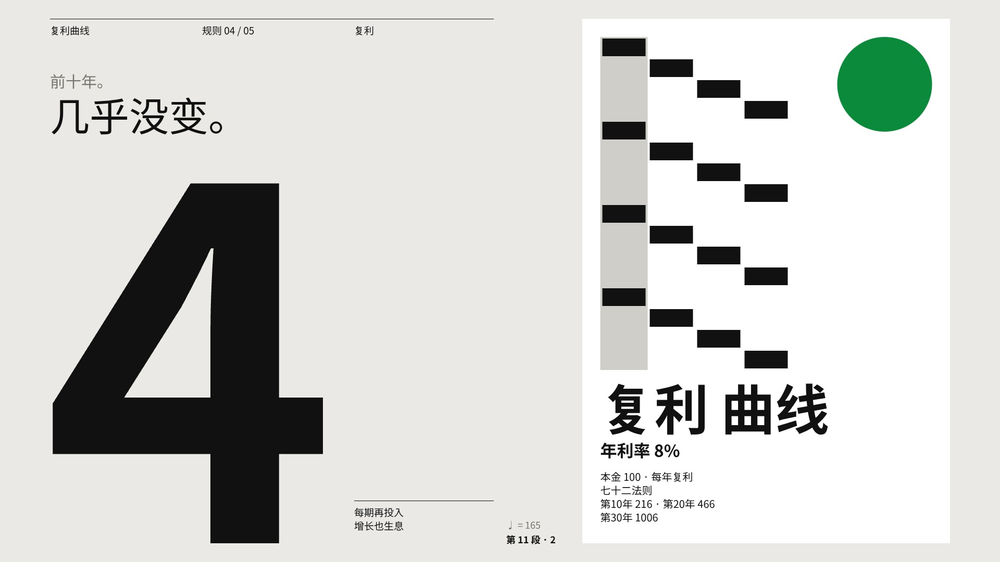
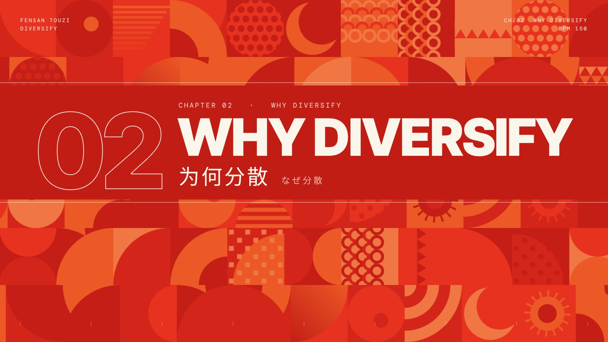
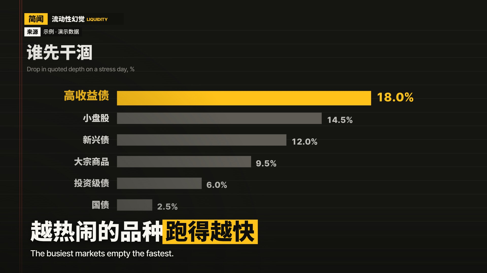
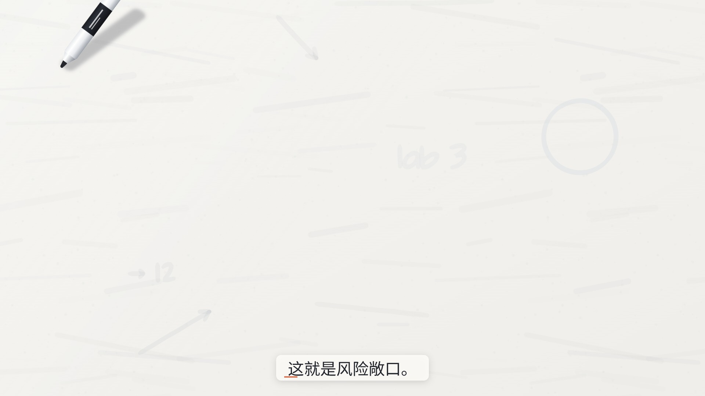
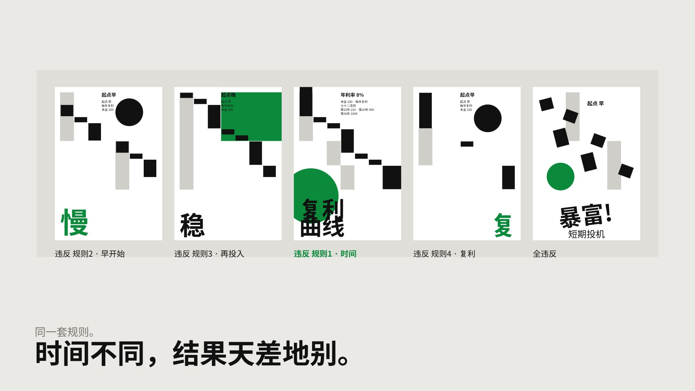
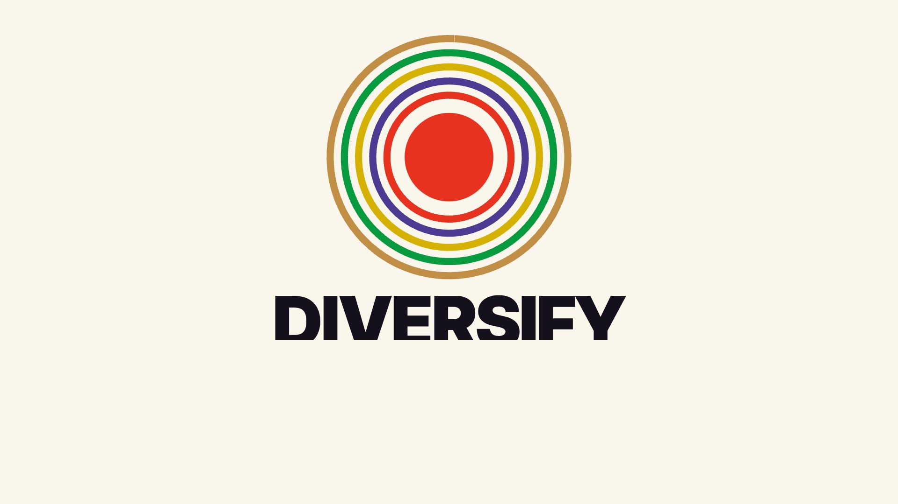
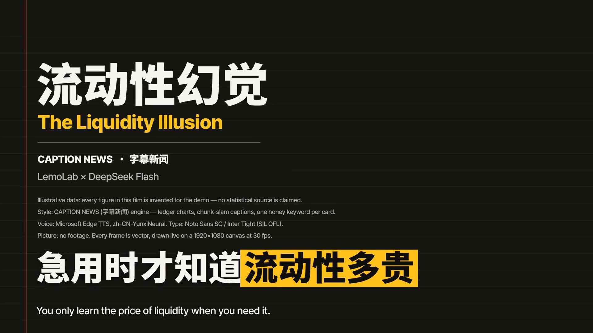
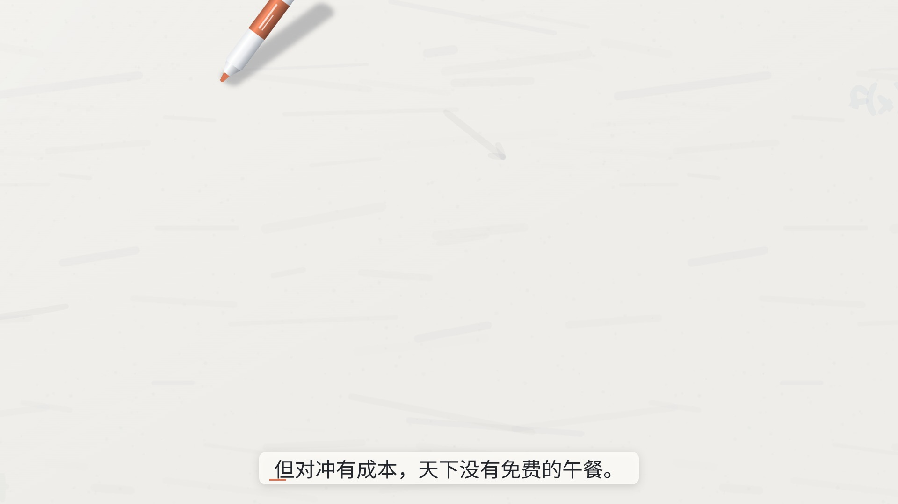

# Showcase · riversxiao’s DeepSeek code-made shorts

This folder is the film wall for [riversxiao/lemo-opuscar](https://github.com/riversxiao/lemo-opuscar): **DeepSeek Flash** (`openrouter/deepseek/deepseek-v4.1-flash`) + upstream Opus demo **engine lock**. Pure code films — **no** Seedance / Kling / Runway / Sora.

Finance vocab is only the **first sample set**. Any topic works (product, pets, travel, tutorials…).

Finished MP4s stay off the main tree — Release **[showcase-v001](https://github.com/riversxiao/lemo-opuscar/releases/tag/showcase-v001)**.

Rules: [`AGENTS.deepseek.md`](../AGENTS.deepseek.md) · [`DEEPSEEK.md`](../DEEPSEEK.md)  
Compare notes: [`COMPARE.md`](COMPARE.md)

## Method (one line)

```
TREATMENT → setup.sh demo <slug> → content layer only → still → TTS/score → video → mix → mux → self-check
```

Flash edits timeline / copy / palette; never shaders, easing cores, `core/`, or in-library `styles/`. Styles that ran best in these samples: **Swiss Motion · Pictogram Motion · Caption News (graphics-only)**; use Whiteboard with care.

## Four sample films

| # | Topic | Style | Length | VO | Stills | Download |
|---|---|---|---|---|---|---|
| 1 | Compound interest | Swiss Motion | ~31 s | Yunxi (zh) | [01](stills/fuli-01.jpg) · [02](stills/fuli-02.jpg) | [mp4](https://github.com/riversxiao/lemo-opuscar/releases/download/showcase-v001/fuli-swiss-ds-v001.mp4) |
| 2 | Diversification | Pictogram Motion | ~31 s | none (drums) | [01](stills/fensan-01.jpg) · [02](stills/fensan-02.jpg) | [mp4](https://github.com/riversxiao/lemo-opuscar/releases/download/showcase-v001/fensan-pictogram-ds-v001.mp4) |
| 3 | Liquidity | Caption News | ~30 s | Yunxi (zh) | [01](stills/liudong-01.jpg) · [02](stills/liudong-02.jpg) | [mp4](https://github.com/riversxiao/lemo-opuscar/releases/download/showcase-v001/liudong-caption-ds-v001.mp4) |
| 4 | What is hedging | Whiteboard | ~32 s | Yunxi (zh) | [01](stills/duichong-01.jpg) · [02](stills/duichong-02.jpg) | [mp4](https://github.com/riversxiao/lemo-opuscar/releases/download/showcase-v001/duichong-whiteboard-ds-v001.mp4) |

### Still previews

<table>
<tr>
<td align="center" width="25%"><br><sub>复利 · Swiss</sub></td>
<td align="center" width="25%"><br><sub>分散 · Pictogram</sub></td>
<td align="center" width="25%"><br><sub>流动性 · Caption</sub></td>
<td align="center" width="25%"><br><sub>对冲 · Whiteboard</sub></td>
</tr>
<tr>
<td align="center"></td>
<td align="center"></td>
<td align="center"></td>
<td align="center"></td>
</tr>
</table>

## Takeaways

- **Most stable**: Pictogram, Caption (graphics-only) — clear content-layer boundary; Flash rarely touches the engine.
- **Solid**: Swiss — `K` time-scale + Chinese sentence split.
- **Hardest**: Whiteboard — single-line font has no CJK → Latin on the board, Chinese VO; absolute seconds, skip ASR word align.

「中文云希」= Microsoft Azure / edge-tts Yunxi, not a human VO.

## Upstream

Engines and 59 styles from [lemomo-ai/lemo-opuscar](https://github.com/lemomo-ai/lemo-opuscar) (Opus 5.5 demos). This showcase only shows this fork’s DeepSeek workflow and films.
